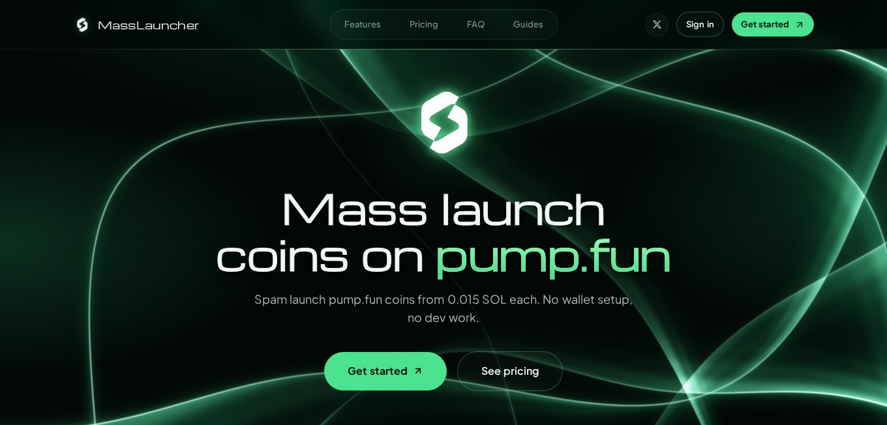

# MassLauncher — Pump.fun batch launcher and API for Solana

Save one coin profile, choose a quantity, and get the mint address for each confirmed Pump.fun launch. Use the website, Telegram, or call the hosted API from your backend.

### [Open the website →](https://masslauncher.fun/?utm_source=github&utm_medium=referral&utm_campaign=masslauncher_api&utm_content=overview) · [Start the Telegram bot →](https://t.me/MassLauncherBot?start=src_github_overview)

**Building with the [Pump.fun batch launch API](https://masslauncher.fun/blog/pump-fun-launch-api)?** Send a saved coin profile and a quantity in one request. Asking for five launches returns one job ID. Read the job to see which coins have confirmed mint addresses and which are pending or failed. [Get an API key](https://masslauncher.fun/app/api-keys?utm_source=github&utm_medium=referral&utm_campaign=masslauncher_api&utm_content=overview).

To test your key without launching anything, [open the Postman walkthrough](https://masslauncher.fun/blog/pump-fun-api-postman?utm_source=github&utm_medium=referral&utm_campaign=masslauncher_api&utm_content=overview). The [included collection](examples/masslauncher-readonly.postman_collection.json) only reads your balance, saved profiles and recent jobs. Zero credits is enough.

Already using Telegram? [Use that same account for the API](https://masslauncher.fun/blog/pump-fun-api-telegram?utm_source=github&utm_medium=referral&utm_campaign=masslauncher_api&utm_content=overview). According to MassLauncher’s founder, multiple multimillion-dollar projects have used the API. That describes the projects, not the value of transactions processed through the service.

## What you can do

| If you want to… | Start here |
| --- | --- |
| Launch from your own artwork or import an existing coin’s details | [Prepare a profile and submit a batch](https://masslauncher.fun/blog/how-to-mass-launch-pumpfun-coins). An import copies details, not the original mint. |
| Know what a batch will cost | [Use the live calculator](https://masslauncher.fun/#pricing). Buying 25 standard credits together costs **0.475 SOL** before extras; you can spend them across several orders. |
| Use your own backend | [Check the API balance and read a launch job](https://masslauncher.fun/blog/pump-fun-launch-api). The first example only reads your credits; it doesn’t launch anything. |
| Find a coin after submitting | [Verify a mint on Solscan](https://masslauncher.fun/blog/verify-pump-fun-launch-solscan). Use the mint address or transaction signature, not the ticker. |
| Choose a batch launcher | [Compare eight Pump.fun launchers](https://masslauncher.fun/blog#batch-launcher-comparisons), including PumpDev, OpenPump and LaunchPier. |

## What a result means

A request for five launches can return a mix of confirmed, pending and failed rows. Open the mint link on a successful row. Leave a pending row alone while it settles; sending the same order again can create another coin. A confirmed mint tells you the coin exists, not that a trading feed displayed it or that anyone bought it. [See how batches and credits work](docs/how-it-works.md).

For actual timing data, see the [100-request Telegram benchmark](https://masslauncher.fun/blog/pump-fun-launch-benchmark). For an example of what launch records can and cannot measure, see the [LUMI campaign breakdown](https://masslauncher.fun/blog/pump-fun-launch-visibility).

## About this repository

This is the public product guide. The live service is hosted at [masslauncher.fun](https://masslauncher.fun/); there is no bot to install from this repository. For a worked first order, see the [companion GitHub quickstart](https://github.com/Mass-Launcher/pumpfun-mass-launcher). For a specific question, see [pricing](docs/pricing.md), [frequent questions](docs/faq.md), or the [full guides library](https://masslauncher.fun/blog).

[Message support on Telegram](https://t.me/susko_insider) · [Updates on X](https://x.com/masslauncher) · [Private security reporting](SECURITY.md) · [License](LICENSE)
